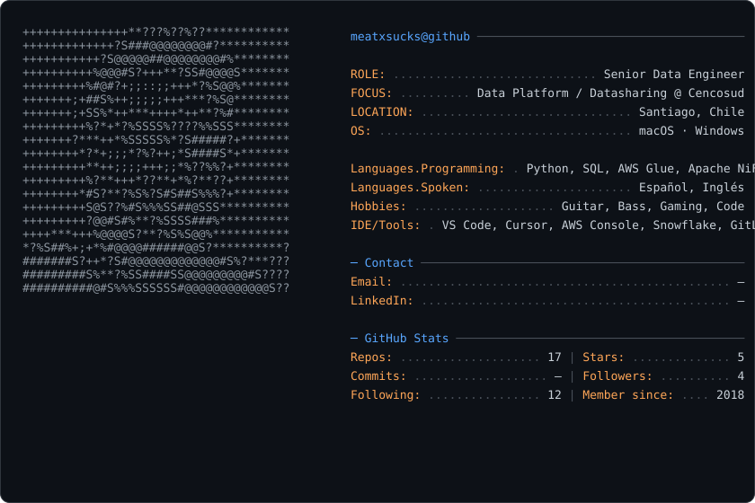

# Hola, soy **Matias Cruz** 👋

**Senior Data Engineer** · *Data Pipelines · Cloud · BI · Automation*

---

## 🖼️ Profile Card

<picture>
  <source media="(prefers-color-scheme: dark)" srcset="dark_mode.svg">
  <source media="(prefers-color-scheme: light)" srcset="light_mode.svg">
  
</picture>

---

## 📊 GitHub Stats

---

## 💼 Sobre mí

Soy **Senior Data Engineer** en el equipo de Productos de **Cencosud (ACL)**, donde integro datos en el producto **Datasharing** — soluciones de Business Intelligence y Big Data para el retail.

Mi trabajo va desde la **arquitectura de APIs** y la **ingesta de datos** (DataLake → AWS Redshift, Snowflake, SAP HANA) hasta la **automatización del despliegue** y la **orquestación** con Apache Airflow y NiFi.

> 🏆 *Disponibilidad del producto Datasharing del 85% al **99%** usando orquestador **MWAA** en AWS.*

### 🎯 Qué hago

- 🔧 **Diseño y mantengo** arquitecturas de APIs y modelos de integración de datos
- 🔄 **Construyo pipelines** de carga: DataLake → Redshift / Snowflake, con NiFi y Spark
- 🧱 **Integro nuevos orígenes**: APIs, RPA, SAP HANA, y modelos de negocio de proveedores
- ☁️ **Defino infraestructura como código** y despliegue automático para productos de datos
- 📊 **Automatizo reportes** en MicroStrategy y Power BI basados en eventos
- 🛡️ **Gobierno de datos**: calidad, trazabilidad, seguridad y cumplimiento normativo

---

## 🛠️ Stack & Herramientas

<table>
<tr><td align="center"><b>Lenguajes</b></td><td>

</td></tr>
<tr><td align="center"><b>Cloud &amp; Data</b></td><td>

</td></tr>
<tr><td align="center"><b>BI &amp; Viz</b></td><td>

</td></tr>
<tr><td align="center"><b>ETL &amp; Orquestación</b></td><td>

</td></tr>
<tr><td align="center"><b>DevOps &amp; Tools</b></td><td>

</td></tr>
<tr><td align="center"><b>AI &amp; IDE</b></td><td>

</td></tr>
</table>

---

## 💼 Trayectoria

### **Senior Data Engineer** · ACL — *Cencosud* (2025 → hoy)
> Integración de datos en el producto **Datasharing**; soluciones de Business Intelligence y Big Data en el equipo de Productos.

- Mantener y mejorar la **arquitectura de APIs**
- Integrar **nuevos modelos de negocio** para proveedores
- Optimizar procesos de **carga y gestión de datos**
- Stack: *AWS Glue, Apache NiFi, MWAA*

### **Senior Data Engineer** · BC Tecnología — *Cencosud* (2025)
> Célula de datos **Datasharing** — desarrollo de soluciones de BI y Big Data.

- Creación de **pipelines** de carga: DataLake → **AWS Redshift**
- Levantamiento de requerimientos que generan valor para **Supermercados**
- Implementación de **nuevos orígenes de datos** (APIs, RPA, SAP HANA)
- Definición de **infraestructura y despliegue automático** para productos de datos
- Desarrollos y automatización de reportes **MicroStrategy** y **Power BI** basados en eventos

**Logros**
- 📈 Disponibilidad del producto Datasharing **→ 99%** con orquestador **MWAA** en AWS
- ⚡ Reducción de tiempos de ejecución de jobs de integración **NiFi** (ventana 09:00 → 07:00)
- 📋 Cuadratura e inventario de procesos, **gobierno y calidad** del producto

### **Data Governance Lead** · Stefanini Group (2024)
> Especialización en **Gobierno de Datos**: calidad, seguridad y cumplimiento normativo.

- Desarrollo de procesos de **ingesta y transformación** en **Snowflake** y **AWS**
- Definición de estándares y estrategias para **calidad, trazabilidad y gobernanza**
- Creación de infraestructura **Cloud como Código (IaC)**
- Aplicación de **regulaciones de privacidad y seguridad**
- Modelado del producto **Patpass** · Integración Oracle → Snowflake · arquitectura **Medallion**

### **Data Engineer** · SmartD (2022–2023)
> Soluciones de análisis de datos e inteligencia de negocios — **Banco BICE**.

- Desarrollo de **ETL**: stored procedures, FTP/SFTP, XML/JSON semi-estructurado, archivos planos, batch y scripts
- **Automatización de despliegues** con versionamiento para pipelines de datos
- Mejora continua del **80% del backlog** del equipo de datos

### **Data Engineer** · Seidor Chile (2021–2022) — *Grupo ESSBIO*
- Tableros **Power BI** de alta disponibilidad
- **SAP BO / SAP Data Services** para AMCOR (Perú) — proyectos Niveles de Inventarios y Tasmania
- Carga de proyectos vía **GitLab** y **Mantis**

### **Consultor BI** · Henley Analytics (2020)
- Dashboards en **SAP Analytics Cloud** para **NISSAN** y **MITTA**
- Automatización de reportes Excel y soporte multi-idioma

### **Analista Senior / Analista de Sistemas TI** · PwC (2018–2020)
- Reproceso de cálculo de **intereses bancarios** · evaluación de riesgos
- Sistema de asignación de clientes en **Google App Script** + **jQuery**
- **Auditorías de riesgo** y pruebas de seguridad · revisión de controles **SAP BASIS**

---

## 🎓 Formación & Docencia

- 🎤 **Relator de cursos** · *Transversal Capacitaciones* (2023) — **Talend ETL** y **Power BI**

---

## 🏗️ Proyectos Destacados

| Repositorio | Descripción | Tech |
|---|---|---|
| **[godot-game](https://github.com/meatxsucks/godot-game)** | Juego en Godot Engine | `GDScript` |
| **[plataforma-datos-chile](https://github.com/meatxsucks/plataforma-datos-chile)** | Plataforma de datos para Chile | `Python` |
| **[cuotazo](https://github.com/meatxsucks/cuotazo)** | Aplicación web | `TypeScript` |
| **[rk-98-pro](https://github.com/meatxsucks/rk-98-pro)** | Proyecto full-stack | `JavaScript` |
| **[Accenture_IA](https://github.com/meatxsucks/Accenture_IA)** | Soluciones de IA aplicadas | `Python` |
| **[jev-openrouter](https://github.com/meatxsucks/jev-openrouter)** | Routing de modelos vía OpenRouter | `JavaScript` |
| **[narrador-tts](https://github.com/meatxsucks/narrador-tts)** | Narrador de texto a voz | `Python` |
| **[slides2video](https://github.com/meatxsucks/slides2video)** | Slides → video automatizado | `Python` |
| **[model-routing-skill](https://github.com/meatxsucks/model-routing-skill)** | Skill de routing de modelos | `Shell` |

---

## 🎸 Fuera del trabajo

Cuando no estoy moviendo datos, estoy con el **bajo** 🎸, la **guitarra** 🎶, los **videojuegos** 🎮 y, inevitablemente, **programando** 💻.

---

## 📫 Contacto

- 💼 **LinkedIn** — [in/matias-cruz](https://www.linkedin.com/in/)
- 📧 **Email** — `matias.cruzdiaz@externos-cl.cencosud.com`
- 💻 **GitHub** — [@meatxsucks](https://github.com/meatxsucks)

---

> 💡 *Este README es generado. La info vive en `scripts/profile-readme-generator.py`.*
> *El arte ASCII sale de tu foto con `scripts/photo-to-ascii.py`.*

**Hecho con ☕ en Santiago, Chile**

